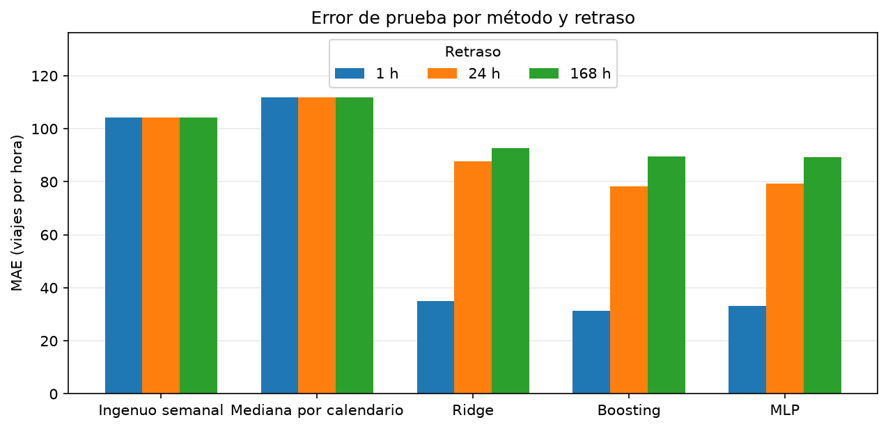

# Pronóstico de viajes horarios de Ecobici Buenos Aires con datos retrasados

Comparativa de cinco técnicas para pronosticar cuántos viajes de **Ecobici** (el sistema público de bicicletas de
Buenos Aires) se inician en cada hora, y de **cuánto empeora cada una cuando el último dato disponible tiene 1, 24
o 168 horas de antigüedad**. Datos reales: 11,9 millones de recorridos de 2022 a 2025.

> **Qué es este repositorio.** Una prueba de capacidades de dos asistentes de IA, **Claude** (Anthropic) y
> **Codex** (OpenAI), encargada por Sebastián (Fundación Social Mentes Brillantes): llevar de principio a fin un
> trabajo con la forma y la exigencia de un Trabajo Fin de Máster en Inteligencia Artificial (tipo «comparativa de
> soluciones»). **No es un trabajo presentado ante ninguna universidad.** El detalle de quién hizo qué está en el
> Anexo A de la memoria, y las instrucciones que recibió Codex, en `proceso_ia/`.

## Resultados

Error absoluto medio (MAE) en viajes por hora, sobre 4.244 horas de prueba (julio a diciembre de 2025; media de
374,7 viajes por hora):

| Método | Dato de hace 1 h | Dato de hace 24 h | Dato de hace 168 h |
|---|---|---|---|
| *Boosting* de árboles | **31,2** | **78,2** | 89,6 |
| Perceptrón multicapa | 33,2 | 79,4 | **89,4** |
| Regresión Ridge | 34,9 | 87,7 | 92,7 |
| Ingenuo semanal | 104,4 | 104,4 | 104,4 |
| Mediana de calendario | 111,7 | 111,7 | 111,7 |
| *Boosting* + clima observado (secundario) | 29,8 | 59,0 | 64,4 |

- **En este caso, la frescura del dato pesó más que el modelo.** Entre modelos competentes hubo un 10 % de
  diferencia; con el dato de hace un día, el error de los modelos ajustados se multiplicó por cerca de 2,5.
- La ventaja del *boosting* sobre la referencia ingenua fue del 70 %, el 25 % y el 14 % con datos de 1, 24 y 168 h,
  significativa en cada escenario (Diebold-Mariano con varianza de Newey-West y corrección de Holm; se mantiene con
  48, 168 y 336 rezagos).
- El clima casi no cambió el error con datos frescos (−4,7 %) y lo redujo mucho con datos atrasados (−25 % a −28 %).
  Ojo: se usó el clima observado (ERA5), que se publica después; no es lo que daría un pronóstico del tiempo.
- Hallazgo de datos: el archivo de 2024 trae 321.015 recorridos de menos de un minuto (frente a 0 en 2022 y 2023 y 8
  en 2025) y 3.379 sin hora de llegada; se filtraron con el mismo criterio en los cuatro años.



## Cómo está hecho

| Paso | Script | Qué hace |
|---|---|---|
| 1 | `src/descargar_datos.py` | Baja los recorridos de Ecobici 2022-2025 (Buenos Aires Data, CC BY 2.5 AR; ~700 MB) y guarda sus huellas SHA-256 |
| 2 | `src/serie_horaria.py` | Lee los CSV con SQL (DuckDB) sin seleccionar nunca las columnas del usuario; depura y arma la serie por hora |
| 3 | `src/descargar_clima.py` | Temperatura y lluvia por hora de Open-Meteo (ERA5, CC BY 4.0) |
| 4 | `src/feriados.py` | Feriados y días no laborables de Argentina 2022-2025, con las correcciones de cada año |
| 5 | `src/ejecutar_todo.py` | Variables por escenario, cinco modelos, validación, prueba, Diebold-Mariano, figuras, tablas y registro de la ejecución (~1 minuto) |

Protocolo: entrenamiento 2022-2024, validación enero-junio de 2025 y prueba julio-diciembre de 2025, con un margen
de siete días entre bloques; los modelos se congelan antes de la prueba y todas las alternativas se evalúan en las
mismas horas. Las catorce pruebas automáticas (`tests/`) comprueban, entre otras cosas, que ninguna variable use datos
posteriores al corte de cada escenario; corren en GitHub Actions con cada cambio.

## Reproducir

Con Python 3.12 (en Linux o macOS, `.venv/bin/python`):

```
python -m venv .venv
.venv/Scripts/python -m pip install -r requirements.txt
.venv/Scripts/python -m pytest -q
.venv/Scripts/python src/ejecutar_todo.py
```

Los datos procesados ya están en `datos/procesados/`. Para reconstruirlos desde los recorridos originales, después
de crear el entorno: `src/descargar_datos.py`, `src/serie_horaria.py`, `src/descargar_clima.py` y `src/feriados.py`,
en ese orden.

## Memoria

La memoria completa está en `memoria/memoria.docx` (y en Markdown, por capítulos, en `memoria/`).

## Licencias

Código: MIT. Texto de la memoria: CC BY 4.0. Datos derivados: recorridos de Ecobici del Gobierno de la Ciudad de
Buenos Aires (CC BY 2.5 AR), depurados y agregados por hora; clima de Open-Meteo y Copernicus ERA5 (CC BY 4.0).
